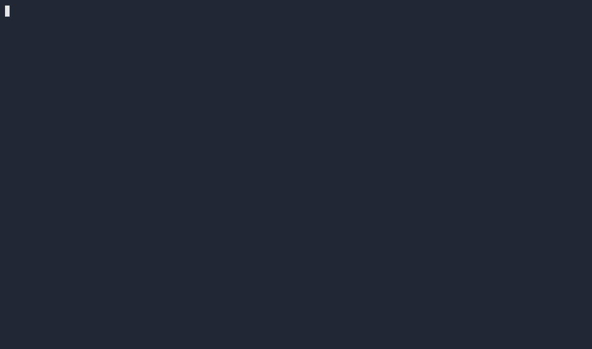

# CRACK OR TRACK
### BY ABO SARA

**Crack the System. Track the Threat.**

A cybersecurity training game with two tracks: **CRACK** (Red Team operations)
and **TRACK** (SOC operations). Learn how attackers find weaknesses and how
defenders detect and respond — in one product.

All scenarios use fictional hosts, logs, and credentials. Nothing in the game
touches a real network.


## Demo



## Features

- **Two tracks** — Red Team (recon, web, API) and SOC (phishing, SIEM, malware)
- **Red vs SOC crossover mission** — the same intrusion from both sides
- **Interactive stages** — analyse output, type commands, make decisions, and
  write findings; not a multiple-choice-only quiz
- **Progressive hints** — four levels per mission, at a score cost
- **XP, ranks, achievements** — progress saved in SQLite
- **Scoring that rewards thinking** — accuracy, methodology, efficiency, time
- **Saudi-inspired green console UI** — emerald accents, gold details,
  red/blue markers for the two tracks

## Quick start (web)

```bash
cd crack-or-track
python3 -m venv .venv
./.venv/bin/pip install -r requirements.txt
./run.sh
```

Open **http://127.0.0.1:8800** — this is **local-only** (your own machine).
To share the app online, use the **Deploy** section below.

## Deploy (live demo)

> **`127.0.0.1:8800` is local-only.** Deploy below to get a public URL that
> other people can open.

The web app ships with a `Dockerfile` and a `render.yaml` blueprint, so it runs
on any Docker host or on Render's free tier.

```bash
docker build -t crack-or-track .
docker run -p 8800:8000 crack-or-track
```

Or on [Render](https://render.com): **New → Web Service → connect this repo** —
Render reads `render.yaml` and deploys automatically. The app answers at
`/health` and serves the UI on port 8000.

## Quick start (terminal)

```bash
python3 cli.py        # opens the main menu
python3 cli.py 2      # jump straight into mission 2
./demo.sh             # scripted playthrough (for recording)
```

The terminal version prints the camel mascot as green ASCII character art.

## Missions

| ID | Track | Title | Category |
|---|---|---|---|
| r1 | CRACK | Silent Recon | Reconnaissance |
| r2 | CRACK | Broken Login | Web application |
| r3 | CRACK | Object Lesson | API security |
| b1 | TRACK | The Urgent Invoice | Phishing analysis |
| b2 | TRACK | Impossible Travel | SIEM investigation |
| b3 | TRACK | Encoded Payload | Malware analysis |
| x1 | CRACK vs TRACK | Suspicious Activity Detected | Red vs SOC |

## Scoring

| Component | Effect |
|---|---|
| Correct stage | contributes accuracy |
| Wrong answer | −4 points |
| Hint revealed | −6 points |
| Finish within estimate | +10 points |

Score is 0–100. XP = score × (1 + 0.25 × difficulty) + 10.

### Ranks

| XP | Rank |
|---|---|
| 0 | Cyber Rookie |
| 250 | Junior Analyst |
| 600 | Security Operator |
| 1000 | Red Team Operator |
| 1400 | SOC Specialist |
| 1900 | Senior Security Specialist |
| 2600 | Elite Cyber Operator |

## Architecture

```
app.py          FastAPI routes (dashboard, missions, stages, hints)
content.py      mission data — stages, options, hints, explanations
engine.py       evaluation, scoring, ranks
db.py           SQLite: players, progress, activity, achievements
templates/      Jinja pages (green console UI)
static/         logo and stylesheet
cli.py          terminal version
quiz.py         quiz bank (English + Arabic)
cli_art.txt     camel mascot rendered as green ASCII character art
cli_wordmark.txt  CRACK OR TRACK block-letter wordmark
tools/          CLI art generator
tests/          engine, scoring, content tests
requirements.txt  Python dependencies
Dockerfile      container image for deployment
render.yaml     Render blueprint
```

## Mascot

A camel mascot (`static/logo.svg`) with gold-rimmed glasses gives the project its identity; the terminal banner is rendered from it as green ASCII art.

## Tests

```bash
PYTHONDONTWRITEBYTECODE=1 python3 -m unittest discover -s tests -v
```

42 tests across the CLI engine and the web scoring engine.

## Disclaimer

Every host, credential, and log line is fictional. Real security testing
requires explicit written authorization.
