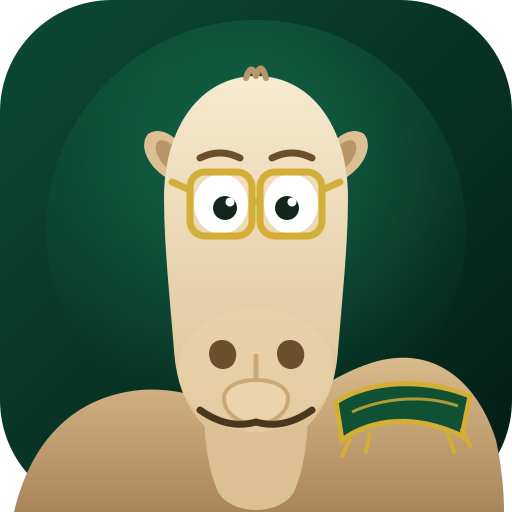

# CRACK OR TRACK
### BY ABO SARA

**Crack the System. Track the Threat.**

A cybersecurity training game with two tracks: **CRACK** (Red Team operations)
and **TRACK** (SOC operations). Learn how attackers find weaknesses and how
defenders detect and respond — in one product.

All scenarios use fictional hosts, logs, and credentials. Nothing in the game
touches a real network.



## Features

- **Two tracks** — Red Team (recon, web, API) and SOC (phishing, SIEM, malware)
- **Red vs SOC crossover mission** — the same intrusion from both sides
- **Interactive stages** — analyse output, type commands, make decisions, and
  write findings; not a multiple-choice-only quiz
- **Progressive hints** — four levels per mission, at a score cost
- **XP, ranks, achievements** — progress saved in SQLite
- **Scoring that rewards thinking** — accuracy, methodology, efficiency, time
- **Saudi-inspired green console UI** — emerald accents, gold details,
  red/blue markers for the two tracks

## Quick start (web)

```bash
cd crack-or-track
python3 -m venv .venv
./.venv/bin/pip install fastapi "uvicorn[standard]" jinja2 python-multipart
./run.sh
```

Open **http://127.0.0.1:8800**.

## Quick start (terminal)

```bash
python3 cli.py        # mission 1
python3 cli.py 2      # mission 2
./demo.sh             # scripted playthrough
```

The terminal version prints the camel mascot using 24-bit colour blocks when
the terminal supports it, and falls back to a clean text banner otherwise.

## Missions

| ID | Track | Title | Category |
|---|---|---|---|
| r1 | CRACK | Silent Recon | Reconnaissance |
| r2 | CRACK | Broken Login | Web application |
| r3 | CRACK | Object Lesson | API security |
| b1 | TRACK | The Urgent Invoice | Phishing analysis |
| b2 | TRACK | Impossible Travel | SIEM investigation |
| b3 | TRACK | Encoded Payload | Malware analysis |
| x1 | CRACK vs TRACK | Suspicious Activity Detected | Red vs SOC |

## Scoring

| Component | Effect |
|---|---|
| Correct stage | contributes accuracy |
| Wrong answer | −4 points |
| Hint revealed | −6 points |
| Finish within estimate | +10 points |

Score is 0–100. XP = score × (1 + 0.25 × difficulty) + 10.

### Ranks

| XP | Rank |
|---|---|
| 0 | Cyber Rookie |
| 250 | Junior Analyst |
| 600 | Security Operator |
| 1000 | Red Team Operator |
| 1400 | SOC Specialist |
| 1900 | Senior Security Specialist |
| 2600 | Elite Cyber Operator |

## Architecture

```
app.py          FastAPI routes (dashboard, missions, stages, hints)
content.py      mission data — stages, options, hints, explanations
engine.py       evaluation, scoring, ranks
db.py           SQLite: players, progress, activity, achievements
templates/      Jinja pages (green console UI)
static/         logo and stylesheet
cli.py          terminal version
cli_art.txt     camel mascot rendered as green ASCII character art
tools/          CLI art generator
tests/          engine, scoring, content tests
```

## Mascot

The camel mascot (`static/logo.svg`) is the game's identity: long muzzle,
gold-rimmed glasses, and a saddle — confident, friendly, and recognisable at
icon size. It is used in the sidebar, dashboard, mission results, and favicon.

The terminal version uses a smoking, relaxed variant (`static/logo_cli.svg`)
rendered as classic character-based ASCII art (`cli_art.txt`) in green at
startup, in the style of classic terminal tool banners. Regenerate it with:

```bash
./.venv/bin/python tools/make_cli_art.py
```

## Tests

```bash
PYTHONDONTWRITEBYTECODE=1 python3 -m unittest discover -s tests -v
```

42 tests across the CLI engine and the web scoring engine.

## Disclaimer

Every host, credential, and log line is fictional. Real security testing
requires explicit written authorization.
